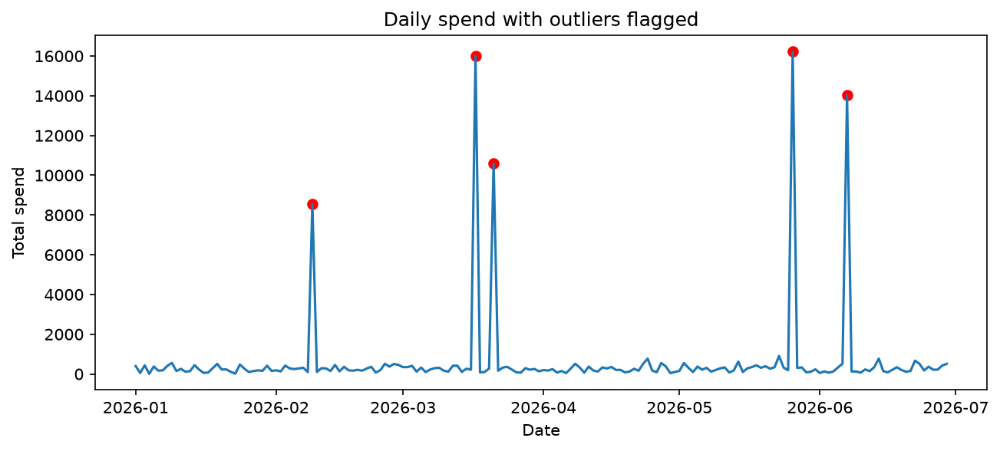

# LedgerLens

A pure-Python auditor for messy bank-transaction data: it cleans bad
records, flags suspicious activity, and writes an audit report.

## Why I built this
Real-world data is rarely clean. I built this to practise core Python
(control flow, data structures, functions, error handling) on a realistic
data-quality problem, using synthetic data only.

## What it does
- Rejects invalid records with a reason (bad amounts, bad dates, blank IDs)
- Removes duplicate transactions
- Flags amount outliers (z-score)
- Detects velocity bursts (too many transactions in a day)
- Compares customer channel usage with set operations

## How to run it
```bash
python -m venv .venv
source .venv/bin/activate
pip install -r requirements.txt
pip install -e .
python generate_data.py
python main.py data/transactions_raw.csv
python -m pytest -v
```

## Results
On the synthetic data (1,026 raw rows): 1,004 clean, 12 rejected,
10 duplicates removed, 5 outliers flagged, 2 burst customers.
See [report.md](report.md).



## Project structure
The structure of this project is as below:

## What I learned


## Next steps
- Rebuild the aggregation in pandas and compare
- Add more detection rules